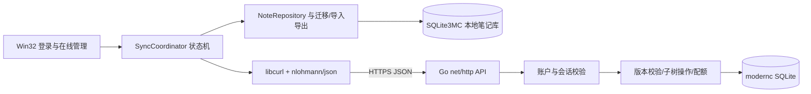

# AnyNote 手动同步：架构和数据流

状态：客户端、服务端和在线管理已实现。当前执行证据、实现细节与剩余人工验收见 [implementation-report.md](implementation-report.md)；进度见 [TODO.md](TODO.md)。

## 1. 模块与技术栈



| 端 | 库/组件 | 用途与约束 |
| --- | --- | --- |
| 客户端现有 | C++20、Win32、RichEdit、GDI+、SQLite3MC | 保留原生界面、RTF 与本地加密格式 |
| 客户端新增 | `nlohmann/json`（vcpkg） | JSON 读写，UTF-8，协议整数范围检查 |
| 客户端新增 | libcurl（vcpkg，固定 OpenSSL TLS 后端） | HTTPS、超时、取消、进度；静态链接 |
| 客户端系统库 | BCrypt、Crypt32 | SHA-256、安全随机数、Base64、DPAPI；不自写密码算法 |
| 服务端标准库 | `net/http`、`crypto/tls`、`crypto/rand`、`crypto/sha256`、`crypto/subtle`、`encoding/json`、`encoding/base64`、`database/sql`、`log/slog` | HTTP 服务、TLS、凭据、序列化、日志 |
| 服务端第三方 | `modernc.org/sqlite` | 不依赖 CGO 的 SQLite 驱动；不读取客户端 SQLite3MC 文件 |
| 服务端第三方 | `golang.org/x/crypto/argon2` | Argon2id 密码散列与校验 |
| 开发工具 | CMake/VS2022/vcpkg、Go、OpenSSL CLI | 编译、依赖固定、生成证书；OpenSSL CLI 不随客户端作为运行依赖 |

客户端 `src/AnyNoteClient/sync/` 包含 `SyncCoordinator`、`SyncClient`、`SyncProtocol`、`DiffEngine`；`storage/` 包含配置迁移、SchemaMigrator、SnapshotService、VaultInstaller 和跨进程文件锁，UI 包含账户与在线管理窗口。服务端位于 `src/AnyNoteServer/`，含 `cmd/{anynote-server,anynote-admin,anynote-cert}`、`internal/{api,store,protocol,config,lease}`。第一版不用 ORM、Web 框架、Redis 或消息队列。

网络工作在工作线程执行；UI 线程保存编辑并持有业务禁用状态，工作线程不得直接访问 HWND 或复用 UI 数据库连接。结果通过有生命周期标识的消息/队列回到 UI；窗口销毁后丢弃过期结果。禁止在 UI 线程等待网络。

## 2. 本地数据模型和迁移

### 2.1 库 UID

新增 `uid(singleton INTEGER PRIMARY KEY CHECK(singleton=1), value TEXT NOT NULL UNIQUE CHECK(length(value)=16))`，仅一条记录。值采用 48 位 Unix 毫秒时间戳加 16 位安全随机数，编码为 16 位小写十六进制字符串。纯时间戳不能保证跨设备唯一；该设计保留“时间戳生成、16 位字符串”，用随机尾部和碰撞检测补足。

UID 不是秘密或授权凭据，也不承诺数学上绝对无碰撞。同进程生成时检查重复并重试；另存为独立新库时检查本地映射。首次上传若服务器已有该 UID，不直接覆盖，必须走绑定/冲突确认；用户确认是独立新库时重建身份。服务器以 `(account_id, uid)` 隔离库。

### 2.2 节点与哈希

- `nodes` 新增 `sync_id TEXT NOT NULL`、唯一索引；采用 UUIDv4（标准连字符、小写），随机数来自系统 CSPRNG。存量迁移先填充再建立非空约束，不使用固定默认 UUID。
- 保留 `id`、`parent_id`、`sequence`、`title`、`node_type`、`created_time`、`modified_time`。本地根父节点仍为 0；跨端父关系用 `parent_sync_id`，根为 null。
- `node_contents.content_hash` 为 RTF 原始字节的 SHA-256，64 位小写 hex；不对渲染文本、Base64 或重新生成的 RTF 求哈希。
- 协议统一空 RTF 为零字节，已有 NULL 和零长度 BLOB 均映射到 SHA-256 空串哈希。不得丢失内嵌零字节。其他内容格式版本在导入前拒绝。
- 内容、哈希、plain_text、修改时间必须同一事务更新；导入保留源端修改时间，不调用会自动写入当前时间的普通编辑 API。`plain_text` 是本地派生索引，不作为差异依据；导入后使用现有转换逻辑重新生成。

使用 `PRAGMA user_version` 管理可重复、事务化迁移。升级前建立可恢复备份；错误密码不尝试迁移。分批计算哈希但不留下可被同步使用的半迁移状态。暂未解锁的库保持待迁移，不为其凭空生成 UID。未知高版本只读拒绝同步，禁止降级重建。

### 2.3 JSON 配置

使用 `anynote.json`，保留旧 INI 作为迁移备份。示例仅表达结构，不含真实配置：

```json
{
  "schema_version": 1,
  "active_vault_path": "notebooks/work.anynote",
  "vault_files": {"0123456789abcdef": "work.anynote"},
  "vaults": [{"uid": "0123456789abcdef", "name": "工作", "path": "notebooks/work.anynote"}],
  "settings": {"View": {}, "Window": {}, "Editor": {}, "Sync": {"ServerUrl": "https://localhost:8443", "CaFile": "certs/server.crt", "Username": "", "RememberPassword": "0", "AutoLogin": "0"}}
}
```

`vault_files` 满足 UID 为键、文件名为值的需求；实际定位用 `vaults.path`，不同目录可同名。路径相对配置目录解析，外部路径允许绝对路径。UID 从打开的数据库核验，配置不是身份权威。同 UID 多副本不写入歧义映射，每次同步显式选择本次目标路径，不自动选第一个。未解锁库允许 uid=null，不写入映射。同步设置复用 `settings.Sync`；早期草案的 `cloud` 节点作为未知字段保留，不参与连接配置。

迁移所有原设置并保留未知 INI 节/键，涵盖当前库、库顺序、显示名、路径、窗口/大纲/编辑设置。写临时 JSON、校验、刷盘、原子替换；失败继续使用原配置，不写空配置覆盖。已有损坏 JSON 时提示恢复备份，不能悄悄从陈旧 INI 回滚。并发实例禁止同时写配置。

云端绑定信息按 `(规范化服务地址, account_id, uid)` 保存到独立本地状态文件，不写入笔记数据；包含远端 epoch、最后观察 revision。密码通过当前 Windows 用户 DPAPI 保护后存独立凭据文件，JSON 只保存开关；复制到另一台电脑需重新登录。备注不落本地库或配置。

## 3. 服务端模型

服务端独立 SQLite 数据库；启动开启外键、WAL、busy timeout，事务连接正确串行使用，耐久写入采用 `synchronous=FULL`。初版写事务串行，读操作使用有界连接池；禁止在等待网络期间持有写事务。

| 表 | 关键字段和约束 |
| --- | --- |
| accounts | account_id、规范化 username UNIQUE、password_hash、salt、Argon2 参数、created_at、credential_version |
| sessions | token_hash UNIQUE、account_id 外键、expires_at、credential_version；不存原 token |
| vaults | account_id、uid 复合唯一，epoch UUID、revision int64、name、remark、created_at、updated_at |
| nodes | account_id、vault_uid、sync_id 复合主键；remote_id（库内唯一整数）、parent_sync_id、sequence、title、node_type、created_time、modified_time、format_type、rtf BLOB、content_hash |
| operations | account_id、operation_id 唯一，request_hash、状态、结果 revision、完成时间；用于幂等 |

所有查询从登录态导出 account_id，客户端不得传入 account_id 决定归属。父子必须属于同一账号同一库；不使用 remote_id 做跨端身份匹配。服务器目录/文件名不由库名、用户名或 UID 拼接成任意路径。

revision 每次库内容变更、备注变更递增一次；epoch 在库创建时随机生成，删除后同 UID 重建也生成新 epoch，防止旧客户端误覆盖新库。创建时间为服务器首次建库时间，更新时间为服务器成功提交时间；节点时间保留来源，不用于决定谁覆盖谁。

## 4. 协议与接口

路径前缀 `/api/v1`；UTF-8 `application/json`；HTTPS only；禁用跨站重定向，令牌不放 URL。所有节点/版本整数使用十进制字符串传输，避免中间工具丢失 64 位精度；sequence、小枚举与计数用有界 JSON 整数。节点时间为 Unix 秒字符串，显示按本地时区；库时间用 UTC RFC3339。

节点字段：`sync_id, source_id, parent_sync_id, sequence, title, node_type, created_time, modified_time, format_type, content_hash, rtf_base64`。`source_id` 仅诊断或空库导入时尝试复用；写入目标时已有 sync_id 保留目标 id，新节点分配目标 id，最后按 sync_id 映射 parent_id。

| 方法/路径 | 行为 |
| --- | --- |
| POST /auth/register | 注册，不自动创建笔记库 |
| POST /auth/login | 登录返回会话 token、account_id、有效期 |
| POST /auth/logout | 撤销当前会话 |
| POST /auth/password | 校验旧密码后修改，撤销全部会话 |
| GET /capabilities | 登录后获取协议/schema 支持范围及配额 |
| GET /vaults | 当前账户库列表，游标分页，默认 100 条 |
| GET /vaults/{uid}/manifest | 固定 epoch/revision 的节点元数据和哈希，不含 RTF；单库限制内一次返回 |
| GET /vaults/{uid}/snapshot | 指定 epoch/revision 读取全量；一致性读事务生成同一版本 JSON |
| PUT /vaults/{uid}/snapshot | 创建或完全替换全库笔记，保留已存在库的备注与首次创建时间 |
| PATCH /vaults/{uid}/remark | 仅修改备注（最多 2,000 Unicode 字符） |
| DELETE /vaults/{uid} | 删除远端库及节点，幂等结果记录独立保留 |
| GET /vaults/{uid}/nodes/{sync_id}/subtree | 指定版本读取子树和祖先信息 |
| PUT /vaults/{uid}/nodes/{sync_id}/subtree | 替换子树，缺失祖先创建；确认影响计划后提交 |
| DELETE /vaults/{uid}/nodes/{sync_id}/subtree | 删除远端节点及全部后代 |
| GET /operations/{operation_id} | 查询丢失响应的变更是否提交 |

写请求包含 `operation_id`（UUID）、`expected_epoch`、`expected_revision`；创建库用显式 `create_only=true` 且不存在前提。删除、改备注也必须校验版本。请求规范化后的业务字段（不含凭据）计算 request_hash；同操作 ID 同请求返回原结果，不同请求返回冲突。同库不同操作同时到达，仅一个相同版本的写入可成功。

响应统一含 `request_id`；错误为 `error:{code,message,retryable}`。HTTP 400 格式/结构非法、401 会话失效、404 不存在或无权访问、409 版本/身份/操作冲突、413 超限、422 内容哈希不符、429 限流、503 临时不可用。错误不得带 SQL、路径、密码或 RTF。缺少写前提返回 400，不允许隐式强制覆盖。

服务器读取、解析、验证完整请求并校验哈希/树结构/配额后才开始写事务，事务内重新验证版本，写节点、更新 revision、记录幂等结果共同提交。禁止先删旧库再验证上传包。库名最多 128 字符，标题最多 1,024 字符；拒绝重复字段、重复 sync_id、非法 Base64、悬空父、环、越界 ID/时间、未知枚举，未知协议主版本拒绝。

## 5. 差异、覆盖与 ID 映射

比较键为 `(uid, sync_id)`。分别比较标题、RTF 哈希、parent_sync_id、sequence、node_type、format_type、创建/修改时间；不比较两端 id、派生 plain_text。时间相同不代表内容相同，时间更晚也不能自动获胜。类别包括仅本地、仅远端、内容不同、标题不同、位置/排序不同、时间不同，可多选。

子树覆盖定义为：源选中节点及全部后代替换目标对应子树，目标子树内独有节点删除。目标子树集合按操作开始前版本计算。源子树中某节点在目标其他位置存在时移动原节点，不复制；如果这个移动会连带影响目标集合之外的后代，预览必须包含这些后代和明确的删除/移动计划，否则拒绝。不得静默丢弃子树外的数据。

缺失祖先从根向下补齐，包含其标题、内容和元数据，但不引入祖先的其他子树；目标已存在祖先不覆盖其内容和元数据。若已有祖先的位置会导致环，阻止操作，要求先同步更高层共同祖先或全库。源根的 parent_sync_id 决定覆盖后的目标位置。

对受影响父节点重新计算确定性 sibling sequence；按源顺序放置导入节点，未参与的目标兄弟保持相对顺序。预览将可能变化的排序列入影响范围，操作后重算所有受影响行；不能承诺子树外绝无位置差异。除导入源字段外，不伪造用户修改时间。

删除不自动传播到另一端，无 tombstone、不自动合并。远端删除后，下一次全库上传可能把本地笔记恢复到远端；确认框必须显示将新增的数量。

迁移前各自独立复制的旧库无法可靠按整数 ID 配对。首次建立共同库：在一端迁移上传，另一端先保留备份再全库下载；禁止猜测匹配。正常全库下载保留已有 sync_id 的本地 id，新节点重新分配，树父关系转换，故两个设备 UI 的整数 id 可以不同。

## 6. 状态机、事务和故障恢复

状态为 Idle → Saving → Planning → AwaitingConfirmation → Transferring → Validating → Committing → Refreshing → Idle；任一失败转 Failed，释放业务锁并显示结果。确认前后的本地 generation 与远端 epoch/revision 都要核验；发生变化重新生成预览，不能沿用旧确认。

全库操作和子树写入均禁止编辑、菜单快捷键、拖拽、切库、导入、自动保存等业务写入；进度窗口和取消按钮仍响应。使用按规范化库路径的进程互斥和跨进程写锁，防止第二实例绕过 UI 禁用；锁冲突直接阻止同步。旧版程序不遵守该锁，验收部署要求不混用旧客户端同时打开库。

上传：保存当前笔记 → 获取版本 → 一致性读取源数据 → 计算影响 → 确认 → 传输 → 服务端验证并事务提交。采用有界流式 JSON 生成与解析，避免 Base64 与原文多份全库复制；第一版不启用 HTTP 压缩。协议包不落明文临时文件；需要落盘时必须使用本地加密暂存库。

下载：读取固定版本数据 → 校验全部内容、树与限额 → 建立备份 → 使用目标现有密钥的暂存库演练导入 → 确认本地 generation 未变化 → 本地同一事务替换笔记及相关身份元数据 → 成功刷新 UI。现有库保持原路径、UID和加密密码；不使用下载数据改密。未知 UID 的下载走新建库，不把另一个 UID 塞入当前库。

优先对已有数据库进行事务内逻辑导入，避免替换打开中的 `.anynote` 文件。备份必须使用已验证保留 SQLite3MC 加密的一致性方法：所有 statement 释放、checkpoint 成功、连接完全关闭后复制主文件并试开；不能直接复制仍在 WAL 写入的主文件。若连接未关闭或存在读者导致 checkpoint 不完整则停止。备份文件同目录 `.sync-backups/<uid>-<UTC>-<operation_id>.anynote`，每库默认保留最近 10 份成功备份，当前恢复依赖的备份不得清理。

本地导入事务同时记录 operation_id 和应用状态；崩溃重启由数据库事务结果判断完成或回滚。下载创建新库时先在目标目录生成并校验，再重命名到目标；用持久化恢复记录协调库文件与配置登记，登记失败保留文件并可重试，不再次覆盖旧库。UI 刷新失败不声称数据库回滚，提示重新打开。

取消仅保证尚未提交时停止。提交阶段禁用取消；若网络断开导致结果未知，显示“结果待确认”，用同一 operation_id 查询，不立即重发新操作。首版操作记录不自动过期，管理员需监控存储；查询不到时重新比较版本/哈希并再次确认，不能把 404 当成未提交。关闭窗口先取消/收束任务，不能留下使用已销毁控件的回调。

## 7. 账户、证书与部署边界

密码散列使用 Argon2id，初始参数 64 MiB、3 次迭代、并行度 1、16 字节随机盐、32 字节输出，存储参数便于升级。登录限流按账号和来源 IP 双维度，默认每分钟 5 次失败，最多 2 个并发密码计算，限流表有界。注册默认关闭，由服务端配置显式开启；注册页关闭时显示原因。

token 为 32 字节随机值的 Base64URL，绝对有效期默认 24 小时；服务端只存 SHA-256。记住密码确实保存 DPAPI 保护的密码，自动登录用其获取新 token；密码、token、本地库密钥不写日志。服务端改密撤销所有会话，客户端清除当前凭据；其他设备下一次请求得到 401。

服务端启动从运行目录 `certs/server.crt`、`certs/server.key` 读取证书和私钥；客户端只分发 `certs/server.crt`，绝不能分发服务端私钥。证书带实际域名/IP 的 SAN，初次可信分发需通过独立可信渠道核验指纹。100 年有效期不等于永久安全；泄露或换地址必须换证，客户端手动更新信任文件。

libcurl 配置专用 CA 文件、`SSL_VERIFYPEER=1`、`SSL_VERIFYHOST=2`，不允许忽略证书错误或退回 HTTP。服务端 TLS 最低 1.2。服务端管理员可读取云端数据；磁盘权限、系统磁盘加密及离线备份由部署负责，账户改密不重加密笔记。

服务端设置 Header 读取、空闲和请求总时限，客户端连接超时 10 秒、连续无进展 60 秒、全操作 10 分钟，限制与进度可见。服务器备份用 SQLite 一致性快照或停服且正确处理 WAL 后备份；禁止运行中单拷贝主文件。恢复必须停止服务，核验数据与账号关系，清除所有旧会话并刷新全部库 epoch，令客户端重新比较后写入。

## 8. 选型依据

- [libcurl CAINFO](https://curl.se/libcurl/c/CURLOPT_CAINFO.html)：指定证书验证信任文件；[VERIFYHOST](https://curl.se/libcurl/c/CURLOPT_SSL_VERIFYHOST.html)：校验连接的主机名。
- [modernc.org/sqlite](https://pkg.go.dev/modernc.org/sqlite)：纯 Go SQLite 驱动，不需要 CGO。
- [Go Argon2](https://pkg.go.dev/golang.org/x/crypto/argon2)：使用 IDKey 实现 Argon2id。
- [Windows DPAPI](https://learn.microsoft.com/en-us/windows/win32/api/dpapi/nf-dpapi-cryptprotectdata)：保护当前用户保存的凭据，换用户/机器后需重新登录。

这些文档用于核对能力，不代表已选定最新版本或已完成集成验证；依赖具体版本在 P0 兼容性验证后锁定。
